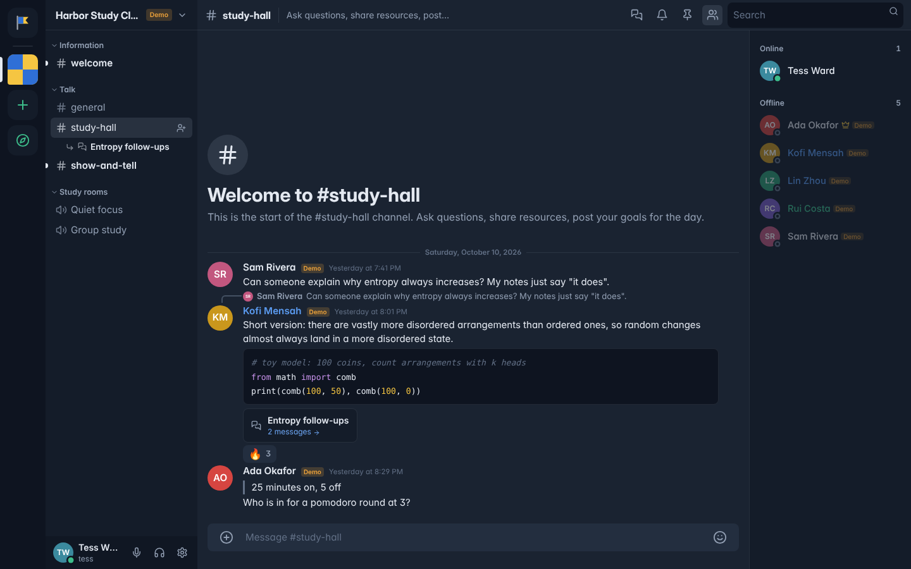
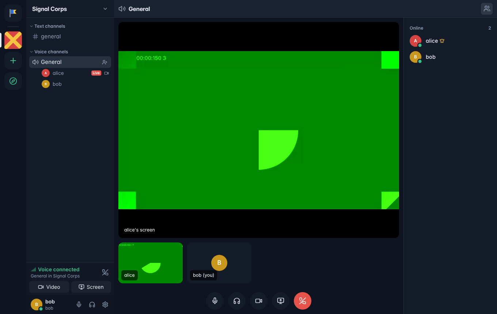
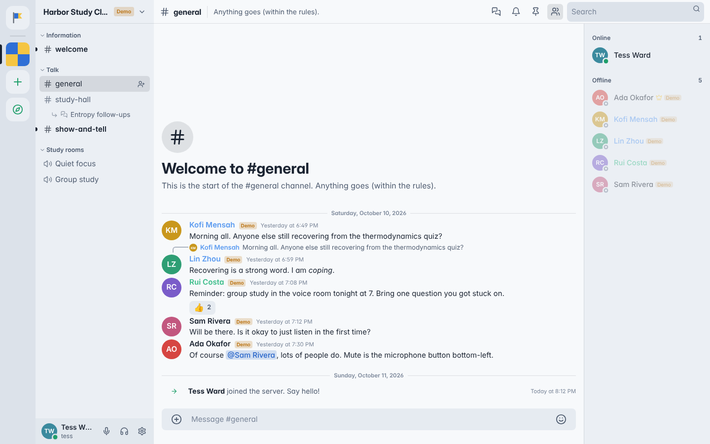
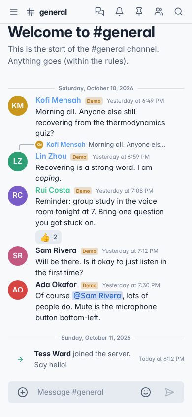

# Parley

A self-hostable community chat platform: servers with text and voice channels, threads,
direct and group messages, roles and permissions, moderation tools, and real voice,
video and screen sharing over WebRTC. The layout will feel familiar to anyone who has used
Discord; the branding, visual design and code are original.

Every server gets its own generated signal flag as an icon (until you upload one), which is
where the name and look come from: a parley is a conversation under a flag of truce.



| Voice call with camera and screen share | Daylight theme | Mobile |
| --- | --- | --- |
|  |  |  |

Sample conversations in the screenshots come from `npm run seed:demo` and are marked "Demo".

## What's in it

- **Accounts**: sign-up, sign-in, email verification, password reset, persistent sessions with a
  device list, profile (avatar, banner, colour, bio, custom status), online / idle / do not
  disturb / invisible.
- **Servers**: create, rename, icon, description, rules, public listing in Discover, invite links
  with expiry and use limits, categories, text and voice channels, private channels,
  ownership transfer, deletion.
- **Messaging**: real-time delivery, edit, delete, replies, threads, reactions, pins, mentions of
  users / roles / channels / @everyone, Markdown (bold, italics, underline, strike, spoilers,
  code blocks with highlighting, quotes, headings, lists, links), attachments (images, video,
  audio, any file) with upload progress, typing indicators, read receipts in DMs, infinite
  scroll, jump-to-message, unread markers, slowmode, idempotent sends.
- **Voice & video**: voice channels and DM calls, mute / deafen, speaking indicators, camera,
  screen sharing, per-person volume, device selection, voice activity or push-to-talk, connection
  status, automatic rejoin after reconnecting.
- **Roles & permissions**: 26 permissions, role hierarchy, per-channel overrides for roles and
  members, all enforced by the server.
- **Moderation**: kick, ban (with message purge), timeout, server mute / deafen / move /
  disconnect, delete messages, AutoMod (keywords, mention spam, links, invites), reports,
  audit log with actor and timestamp, user blocking.
- **Notifications**: desktop notifications and sounds, unread badges, per-server and
  per-channel levels, mutes with durations, @everyone suppression, Do Not Disturb.
- **Settings**: account, profile, privacy, blocked users, devices, appearance (4 themes, accent
  colour, 5 fonts, text size, spacing, compact mode), accessibility (reduced motion, higher
  contrast, saturation, link underlines), voice & video, notifications, keybinds.
- **Search**: messages (with author / content-type / scope filters and permission checks),
  people, channels (quick switcher, `Ctrl+K`), public servers.

[docs/FEATURES.md](docs/FEATURES.md) lists every requested feature with its status and how it
was verified, including what is **not** done.

## Quick start (local)

Requirements: **Node.js 22.5+** and **PostgreSQL 14+** (16 recommended).

```bash
# 1. Database
createuser parley --pwprompt          # e.g. password parley_dev_pw
createdb -O parley parley
createdb -O parley parley_test        # only needed to run the tests

# 2. App
cp .env.example .env                  # edit DATABASE_URL if needed
npm install
npm run dev                           # http://localhost:3000
```

The server applies database migrations on start. With no SMTP configured, verification and
reset emails are printed to the console and kept at `GET /api/dev/outbox` (development only).

Optional sample data, clearly marked with "Demo" badges and listed in Discover:

```bash
npm run seed:demo                     # create
npm run seed:demo -- --remove         # remove it again
```

Demo accounts have random passwords and can't be signed into.

## Commands

| Command | What it does |
| --- | --- |
| `npm run dev` | Rebuilds the client on change and restarts the server on change. |
| `npm run build` | Production build: `dist/client` (static app) and `dist/server.js`. |
| `npm start` | Runs the production build. |
| `npm run migrate` | Applies database migrations (also done on start). |
| `npm run typecheck` | TypeScript check of server, client and tests. |
| `npm test` | API integration tests against `TEST_DATABASE_URL` (wiped each run). |
| `npm run test:e2e` | Two real Chromium browsers chat and call each other. Run `npm run build` first; needs `npx playwright install chromium` once. |
| `npm run seed:demo` | Adds a demo server and demo users. |

## Tests

- `tests/api` (44 tests): authentication and sessions, email verification and password reset,
  rate limiting, CSRF origin checks, upload sniffing, every permission boundary (non-members get
  404, members without a permission get 403), role hierarchy, private channels and overrides,
  timeouts, bans, audit log, invites, discovery, real-time delivery and audience filtering,
  idempotent sends, edits/deletes, replies, reactions, pins, mentions, pagination, attachments
  and their access control, typing, slowmode, AutoMod, threads, reports, DMs and blocking,
  group DMs, presence, voice signaling isolation and server mute, DM calls, search, and the
  SMTP client.
- `tests/e2e` (2 tests): two browsers sign up, create a server, invite, chat live, see typing,
  react, reload, join voice and verify that **audio and video bytes actually flow** over the
  WebRTC connection, screen share, server-mute, DM each other; plus the mobile layout.

## Documentation

- [docs/ARCHITECTURE.md](docs/ARCHITECTURE.md): how it's built, data model, realtime protocol, permissions.
- [docs/DEPLOYMENT.md](docs/DEPLOYMENT.md): production setup, reverse proxy, TURN, email, scaling.
- [docs/FEATURES.md](docs/FEATURES.md): feature-by-feature status and known gaps.

## Project layout

```
server/           Node.js backend (no framework): HTTP API, WebSocket gateway, voice signaling
  db/             PostgreSQL wire-protocol client, pool, migrations
  routes/         auth, users, servers, channels, messages, dms, moderation, misc
  services/       access control, serializers, state snapshots, AutoMod, audit log
  realtime/       gateway (presence, typing, fan-out) and voice rooms
shared/           permission bitfield shared by server and client
client/src/       React app (Tailwind CSS)
  lib/            store, gateway client, router, API client, Markdown, notifications
  voice/          WebRTC engine (mesh, perfect negotiation, WebAudio mic pipeline)
  views/          layout, channels, chat, voice stage, settings
scripts/          build, dev, demo seed
tests/            api/ integration tests, e2e/ browser tests
```
